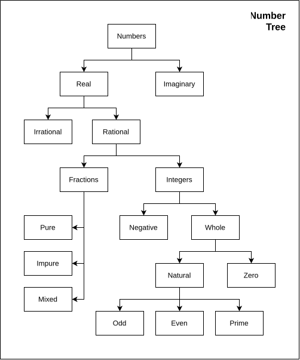

A **Number** is a mathematical value, which is used to count, measure, label, or calculate a quantity. A **Number System** is a structured framework used to represent these numbers using digits and symbols. The number system can be divided into :
- **Binary Number System** ( Base-2 ) : uses only 2 digits - 1 & 0. 
- **Octal Number System** ( Base-8 ) : uses 8 digits - 0 to 7.
- **Decimal Number System** ( Base-10 ) : uses 10 digits - 0 to 9.
- **Hexadecimal Number System** ( Base-16 ) : uses 16 digits - 0 to 9, A to F (10 to 15).

In Aptitude, we will deal with Decimal Number System.

---

---
- **Real Numbers** ( R ) : numbers that can be represented on a number line and represent a actual quantity. Square of a Real number is always positive or zero. e.g. 52 = 25 and (-5)2 = 25.
 
- **Imaginary Numbers** ( i ): cannot be represented on a number line and are created by multiplying a real number by the imaginary unit ' i ', where i = $\sqrt{- 1}$ . The square of a imaginary number is always a real negative number. e.g. 7i or ( 7 x $\sqrt{-1}$ )2 = 49 x ( -1 ) = -49. These numbers are generally used to solve equations which have no real solution like x2 = -9.
 
- **Complex Numbers** ( C ) : numbers that combines both real and imaginary numbers. it is generally written as a+bi , where a is a real number and bi is a imaginary number.
 
- **Rational Numbers** ( Q ) : numbers that can be expressed as the ratio of two numbers.
	- can be expressed as p / q , where p and q are integers (whole numbers) and q $\neq$ 0.
	- Decimal form : either terminates ( 1 / 4 = 0.75 ) or repeats a pattern ( 1 / 3 = 0.333... ).
	- Includes : All integers (positive, negative, zero), Common fractions, Perfect square roots ( $\sqrt{25}$ = 5 and 5 can be written as 5 / 1 ).
 
- **Irrational Numbers** ( P or I or R \ Q means Real numbers excluding Rational numbers ) : numbers that cannot be expressed as ratio of two numbers.
	- Decimal Forms : Non-Terminating and Non-Repeating , i.e. decimals continue infinitely with no repeating sequence.
	- Includes : Non-Perfect square roots ( $\sqrt{2}$  = 1.4142356... ), Mathematical Constants ( $\pi$ , etc ), The golden ratio ( $\phi$ ).
	- Not rational, but can be represented on a number line. Between any two numbers there can be infinite irrational numbers.
 
- **Fractions** : represents part of a number. It consists of Numerator and Denominator.
	- **Proper / Pure Fractions** : the numerator is smaller than the denominator and the value is always less than 1. e.g. 2/5 , 3/4 , 1/8 , etc.
	- **Improper / Impure Fractions** : the numerator is greater than or equal to the denominator and the value is always equal or greater than 1. e.g. 5/3 , 4/4 , etc.
	- **Mixed Fractions** : a combination of whole number and a proper fraction, the value is greater than 1. e.g. 1$\frac{1}{2}$ , 2$\frac{3}{4}$ , etc.
	- **Unit Fractions** : a type of proper fraction where the numerator is always 1. e.g. 1/2 , 1/4 , 1/5 , 1/10 , etc.
	- **Like Fractions** : a set of two or more fractions that have same denominator. e.g. 1/7 , 2/7 , 5/7 , 4/7 , etc.
	- **Unlike Fractions** : a set of two or more fractions that have different denominators. e.g. 1/3 , 2/4 , 3/5 , etc.
	- **Equivalent Fractions** : different fractions that represents same numerical values or proportion. e.g. 1/2 , 2/4 , 3/6 are equivalent fractions because they simplify to same amount.
 
- **Integers** ( Z ) : denoted by Z or I. includes all negative, zero, and positive numbers. they do not include any fractions or decimals. Z = { ..., -3 , -2 , -1 , 0 , 1 , 2 , 3 ,... }. positive integers are also known as Natural Numbers, and Positive + Zero are known as Whole Numbers.
 
- **Whole Numbers** ( W ) : includes zero and all positive integers. W = { 0 , 1 , 2 , 3 , ... }.
- **Natural Numbers** ( N ) : all positive integers. N = { 1 , 2 , 3 , 4 , ... }.
- **Even Numbers** : divisible by 2. includes 0.
- **Odd Numbers** : Not divisible by 2. includes 1.
 
- **Prime Numbers** : which are only divisible by 1 and themselves. i.e. these numbers have only two factors 1 and itself. e.g. 2, 3, 5, 7, etc.
- **Twin Prime** : pairs of prime numbers which differ by 1. e.g. ( 2 , 5 ) , ( 5 , 7 ) , etc.
- **Co-prime** : two natural numbers are said to be co-prime if their GCD or HCF is 1. e.g. HCF of 3 and 5 is 1, we can say that ( 3 , 5 ) are co-prime.
- **Composite Numbers** : Natural numbers which are not prime.
>**Note** ; 1 is neither prime nor composite.

- **Perfect Number** : a number whose sum of factors (excluding itself) is equal to the number itself. e.g. first perfect number is 6. factors of 6 are 1, 2, 3, 6 and 1 + 2 + 3 = 6 itself. more examples includes 28, 496, 8128, etc.
 
- **Face Value** : of a digit is its own value. e.g. in 631 , the face value of 6 is 6, 3 is 3, 1 is 1.
- **Place Value** : of a digit is given by multiplying it with value of place. e.g. in 631, the place value of 6 is 6 x 100 = 600, 3 is 3 x 10 = 30 , 1 is 1 x 1 = 1.

---
### Some important Points
- odd + odd = even
- odd - odd = even
- odd + even = odd
- odd - even = odd
- even + even = even
- even - even = even
- even + odd = odd
- even - odd = odd
- odd x odd = odd
- even x even = even
- odd x even = even
- even x odd = even
- oddx = odd
- evenx = even
 
- if n is odd, n ( n2 - 1 ) is divisible by 24.
- if n is odd & prime, except 3, then n2 - 1 is divisible by 24.
- if n is odd, 2n + 1 is divisible by 3.
- if n is even, 2n - 1 is divisible by 3.
- if n is odd, 22n + 1 is divisible by 5.
- if n is even, 22n - 1 is divisible by 5.
- if n is odd, 52n + 1 is divisible by 13.
- if n is even, 52n - 1 is divisible by 13.
 
- The lowest prime number is 2.
- 2 is also the only even prime number.
- The lowest odd prime number is 3.
- There are 25 prime numbers between 1 to 100.
- The remainder of division of the square of a prime number p >= 5 divided by 24 or 12 is 1. example -  72 = 49%24 = 1 , and 49%12 = 1.

---
### Questions :-
>**Q.** if a and b are odd numbers, then which of the following is even ?
>(a) a + b + 1
>(b) a + b + 2
>(c) ab
>(d) ab + 2
>
>

Click to reveal answer
option (b) a+b+2 is correct answer.
 

>**Q.** a , b $\in$ I (integers), and a + a2 b3 is odd, then
>(a) a and b both are odd
>(b) a and b both are even
>(c) a is even and b is odd
>(d) a is odd and b is even
>

Click to reveal answer
option (a) is correct answer.

