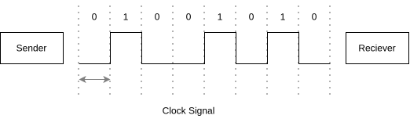
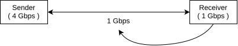

---

---
---
**OSI** stands for **" Open Systems Interconnection "**. where the term "Open Systems" means two or more systems can communicate ( Interconnect ), regardless of their software or hardware architecture. It divides the whole network into 7 distinct layers.
- It was developed and standardized by ISO ( International Organization for Standardization ).
- It is highly regarded as a conceptual framework and a reference model, because it is not practically used. It is studied for understanding the concepts of network layers and their functions.

| No. | Layer Name   | PDU                                  | Function                                                                          |
| --- | ------------ | ------------------------------------ | --------------------------------------------------------------------------------- |
| 7   | Application  | Data                                 | Interface between user and network                                                |
| 6   | Presentation | Data                                 | Translation - Compression - Encryption                                            |
| 5   | Session      | Data                                 | Maintains sessions and authentication                                             |
| 4   | Transport    | Segment (TCP) User Datagram (UDP) | Segmentation - Transport - Reassembly process-to-process / end-to-end delivery |
| 3   | Network      | Packet / Datagram                    | Routing , Host-to-Host delivery                                                   |
| 2   | Data-Link    | Frames                               | Framing , Node-to-Node delivery                                                   |
| 1   | Physical     | Bits                                 | Sends bits over transmission medium                                               |
> Layer 5, 6, 7 are called Upper / Host / User-Support Layers.
> Layer 4 (transport) acts as a interface between Upper and Lower Layers.
> Layer 1, 2, 3 are called Lower / Media / Network-Support Layers.
---
### Layer 1 : Physical Layer
It is the lowest layer, and is responsible for transmitting raw bits over physical hardware.

> **Encoding** & **Decoding** : physical layer is responsible for converting Data to Signals (Encoding), so that signals can travel through wired or wireless mediums. and on receivers side, these signals are converted back to data (Decoding).

> **Modulation** & **Demodulation** : physical layer is responsible for modifying signal's properties like amplitude, frequency, or phase. This is done to convert Digital signals to Analog signals (modulation), and Analog signals to Digital Signals (Demodulation).

> **Bit Synchronization** : physical layer ensures that both sender and receiver are "in sync", by providing them same clock signals.
> 
> The mismatch between clock signals can lead to corrupted data. What sender sends - is wrongly interpreted by receiver. That is why clock signals are synced.

> **Bit-Rate Control** : No. of bits per second (Bit-rate) must be same for both sender and receiver. and is often decided by the "Least Value". so that amount of data sent is same as amount of data recieved. 
> 
> 

> **Transmission Modes** : physical layer also decides whether transmission mode will be simplex, half-duplex, or full-duplex.

> **Physical topology** : the physical arrangement of devices on a network is called its physical topology and its also decided at physical layer.