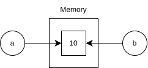
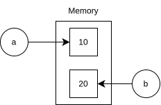
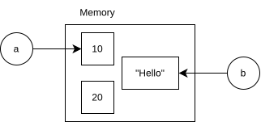

A variable is commonly described as a named storage location. However, in python, a more technical way to describe is : as " *A variable is a name or label that is assigned to an object in memory.* " and that particularly states that in python - variables do not directly contain values, instead an object such as an integer object or any other datatype's object is created inside memory, and the variable points to it. That is why in python we can reassign a variable easily to different datatypes.

```python
a = 10
b = a
```

b also points to same object as a , and does not copy the object to save memory.



And if we reassign b's value, here is what happens conceptually :
```python
b = 20
print(a) # outputs 10
print(b) # outputs 20
```



also we see that due to dynamic typing - we can reassign variables to different datatypes :
```python
b = "hello"
```



>Note that the 20 (integer object) becomes garbage, and will be automatically cleaned by python's garbage collector. (To be discussed later)

Also unlike c, c++, java, etc, python is a dynamically typed language - that means that python variable do not require declaration. And its type is automatically determined at runtime (dynamically typed).

Important points to remember about variables are :
- **Dynamic Typing** : names can be rebound to objects of different types during execution.
- **Strong Typing** : python does not implicitly treat every object as interchangeable with every other type.
- **Name Binding** : Assignment binds a name to an object.
- **Object Identity** : an object's identity is what distinguishes it from other objects during its lifetime and not the variable name. use `id()` to see object identity.  
- **Reference semantics** : multiple names can refer to same object.

>**Note** : python is dynamically typed, not weakly typed. Dynamic typing is associated with determining types. while Weakly Typed languages like javascript loosely enforces type rules. if you try to add a string and a number, it will silently convert one type to match other rather than throwing an error. but python never does this, if any operation does not makes sense - python throws a TypeError. This applies to implicit conversions, however you can use explicit conversions in python. 
>

| Language type                | Example      | Result                           |
| ---------------------------- | ------------ | -------------------------------- |
| JS (weakly typed)            | "5" + 2      | "52" (converts number to string) |
| Python (strongly typed)      | "5" + 2      | TypeError                        |
| Python (explicit conversion) | int("5") + 2 | 7                                |

>So remember that python is a Dynamically typed, and Strongly Typed language.


---
As variable names are also identifiers - they follow same naming rules as identifiers :
- Identifiers may contain letters, digits, and underscores.
- They cannot start with a digit.
- They are case-sensitive: `age`, `Age`, and `AGE` are different names.
- Reserved keywords, such as `if`, `class`, and `return`, cannot be used as ordinary identifiers.
- Names such as `_count`, `__count`, and `__count__` have different conventions or special meanings depending on context.

---
### Constants ?
A constant is a value that is intended to remain unchanged throughout a program's execution. But unlike other languages - **Python does not provide a general-purpose `const` keyword**. That means we cannot make make any constant natively on python. Instead python uses naming convention like UPPERCASE_WITH_UNDERSCORES.

```python
PI = 3.14159
MAX_USERS = 1000
DATABASE_NAME = "student_db"
```

These names communicate that their values should not be changed. However, Python does not automatically prevent reassignment.

```python
MAX_USERS = 1000
MAX_USERS = 2000  # Valid Python
```


---
### Variable Scope
- **Local** : names defined in a local area.
- **Enclosing** : name in enclosing spaces like functions, accessible to that function only.
- **Global** : accessible everywhere.
- **Built-in** : names provided by python's built in namespace,  such as `len` , `print` , etc.


---
### Common tricky expressions

>**Chained Assignment**
>```python
>a = b = []
>a.append(5)
>print(b) # outputs [5] , both refer to same list
>```

>**Reassignment vs Mutation** 
>```python
>a = [1, 2]
>b = a
>a = a + [3]
>print(a) # [1, 2, 3]
>print(b) # [1, 2]
>```
>`a + [3]` creates a new list and a is rebound 