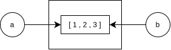

### Mutable vs Immutable Objects

**Immutable Objects** are objects whose value cannot be modified after its creation. examples : `int`, `float`, `bool`, `str`, `tuple`, `frozenset`, `bytes`. Note that changing value by reassigning changes the variable reference only. The object in the memory does not change, instead a new object is created and the variable is rebound to the new object (As seen eralier).

```python
x = 10
x = x + 5
```
The addition produces an integer result, and `x` is rebound to that result. The original integer object is not modified.

**Mutable Objects** are objects whose value can be modified after creation. Examples : `list`, `dict`, `set`, and most user-defined class instances.

```python
items = [10, 20]
items.append(30)
```
The list object is modified, and the name `items` still refers to the same object. 

Lets see another example :
```python
a = [1, 2]
b = a

b.append(3)

print(a)
print(b)
```
Output :
```
[1, 2, 3]
[1, 2, 3]
```
This happens because a and b - both refer to the same object. modifying it from any variable will result changes in both.



>Note that Mutation and Reassignment are two different things. Examples
>
>```python
>a = [1, 2]
>b = a
>b.append([3,4]) # Mutation
>print(a) # outputs [ 1 , 2 , [ 3 , 4 ] ]
>print(b) # outputs [ 1 , 2 , [ 3 , 4 ] ]
>```
>```python
>a = [1, 2]
>b = a
>b = [3,4] # Reassignment
>print(a) # outputs [ 1 , 2 ]
>print(b) # outputs [ 3 , 4 ]
>```
